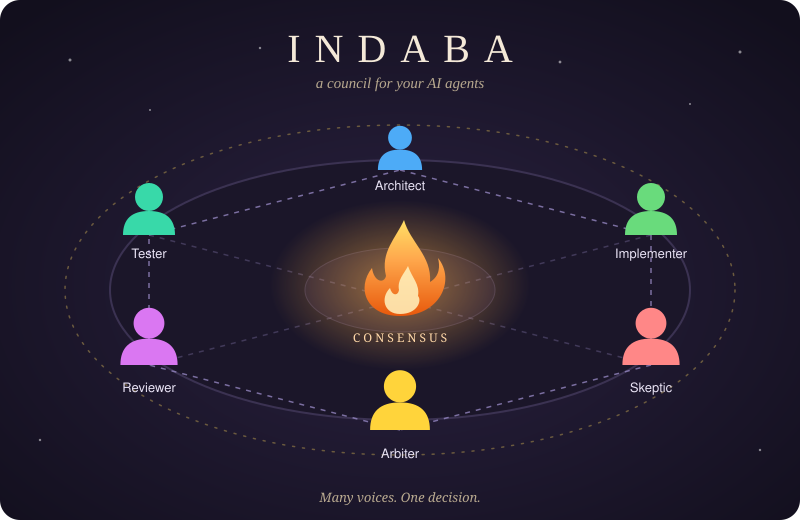
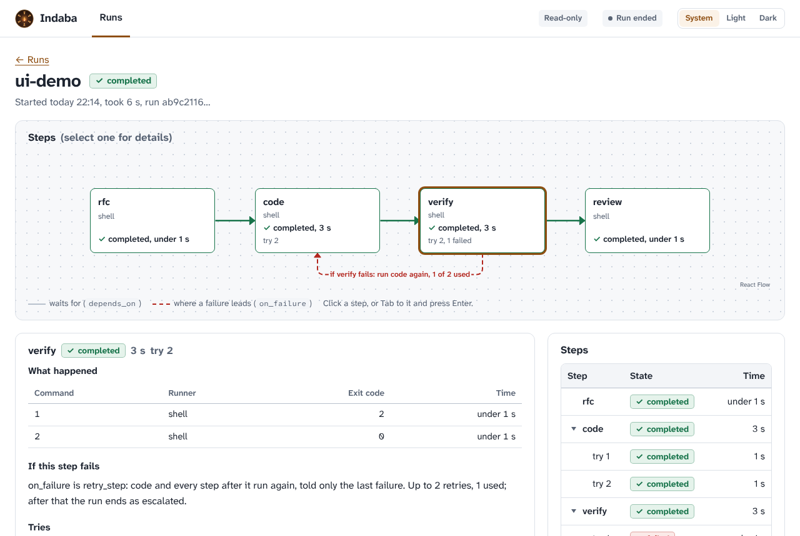

<p align="center">
  
</p>

# Indaba

<p align="center">
  
</p>

**A council for your AI agents.** Indaba is an open-source, deterministic orchestration, debate and
observability engine for AI agents, written in TypeScript for Node 22 and newer. It runs the same on
Windows, macOS and Linux. The name is Zulu for a gathering convened to resolve a hard matter by
reaching consensus.

```bash
npx indaba@next validate workflow.ai.yml
npx indaba@next plan workflow.ai.yml
npx indaba@next run workflow.ai.yml
```

> **Status.** A preview: `0.1.0-alpha.3` (2026-10-26) is the newest published version (`npx indaba@next` runs it;
> `latest` is still `0.1.0-alpha.0`). The API is not stable below 1.0. To work on Indaba, run from a checkout (see
> [Development](#development)).

**Documentation:** [yaotzin1.github.io/indaba](https://yaotzin1.github.io/indaba/), built from [`docs/`](docs/README.md).

- **Deterministic pipelines.** A declarative workflow file is a DAG of steps with quality gates,
  filesystem guards and artifact handoffs. The engine, not a model, decides what runs next.
- **Multi-agent cross-examination.** Roles are backed by different engines (ACP agents such as
  Claude, Codex, Gemini and OpenCode; the Claude Code, Codex, Cursor, Antigravity and OpenCode CLIs; models over
  OpenRouter or any OpenAI-compatible API) and review each other through a blackboard
  with a consensus arbiter, quorum rules and ping-pong detection.
- **Isolation.** A step can run in an ephemeral `git worktree` (`isolation: git_worktree`); the result
  leaves as a patch artifact and the worktree is always removed.
- **Observability.** Every task is a trace; steps and LLM or tool calls are spans carrying
  OpenTelemetry GenAI attributes, token counts and USD cost where known, written to
  `.indaba/traces/<traceId>.jsonl`.
- **A page to watch it in.** A local web view (`indaba ui`) shows your runs and follows one live: the steps as a graph,
  what each did, where a failure leads, and what it cost. It also starts and stops runs, lists your workflows, and edits
  a workflow as a form, a graph or text ([docs/web-view.md](docs/web-view.md); from a checkout for now).
- **Notes between steps.** A step can leave short notes (a result, a fact, a question) on a run board and a later step can
  read them, so agents hand work on without sharing a whole conversation. A debate's messages and outcome land on the same
  board. `indaba watch --plain` ends with it and the dashboard has a board pane
  ([docs/playbook.md](docs/playbook.md#reading-the-board)).
- **Not only for code.** A step is an agent, an API call or a command, so a workflow can drive any
  tool reachable by `shell` or an MCP server: for example a media pipeline. Indaba ships no integration
  with any particular application.

MIT licensed. [`docs/vision.md`](docs/vision.md) is the founding requirement, and
[`docs/positioning.md`](docs/positioning.md) says what Indaba is for, what it is not, and which parts exist today.

## What does "Indaba" mean?

**Indaba** (isiZulu, also used in isiXhosa and other Nguni languages) means a *council*, a
*conference* or *a matter for discussion*: the traditional gathering where elders and community
members talk a difficult question through, hear every voice and reach a shared decision. That is the
job this tool does for AI agents: an architect, an implementer and a reviewer, each possibly a
different model or vendor, put their positions on the table, cross-examine each other, and the work
moves forward only when the council reaches consensus.

## What is it for?

AI coding agents are powerful but unreliable alone: they declare victory without running the tests,
edit files they were told not to touch, and agree with themselves. Indaba is the layer around them
that makes the outcome trustworthy and inspectable:

- Run a pipeline you can reason about: spec, implementation, verification, review, as a declared
  graph of steps instead of one long chat.
- Stop agents marking their own homework. Verification is plain commands (`pnpm test`) whose exit
  codes decide pass or fail; review is a structured debate that needs quorum.
- Enforce boundaries. An RFC step cannot touch `packages/`; implementation happens in a disposable
  worktree and leaves as a patch.
- Retry without drowning the model. A failed step is retried with only the latest failure.
- See what it cost. Every step and LLM call is a span with token counts, latency and USD cost.

## Packages

| Package | Holds | Dependencies |
| :--- | :--- | :--- |
| `indaba` | The command line (`validate`, `plan`, `run`, `watch`, `ui`, `report`, `settings`, `schema`, `catalog`, `workflows`), plugin loading, the composition root | the three below; optional `@indaba/tui` and `@indaba/server` |
| `@indaba/core` | The pure domain: workflow model, DAG, step state, mesh, `Runner`, `Guard`, `Plugin` and `PluginHost` contracts, tracer. Imports no `node:` module | none |
| `@indaba/engine` | Workflow parser and validator with positioned problems, the workflow file's JSON Schema, `WorkflowDocument` (edits a file and keeps its comments), guards, `WorkflowEngine`, git worktrees, JSONL span exporter | `@indaba/core`, `yaml` |
| `@indaba/runners` | `ShellRunner`, `OpenAiCompatibleRunner` and `OpenRouterRunner`, `AcpRunner`, the agent CLI runners, `RunnerRegistry` | `@indaba/core`; optional `node-pty` |
| `@indaba/tui` | Optional terminal dashboard for a run (`indaba watch`, `indaba run --tui`), built on Ink | `@indaba/engine`, `ink`, `react` |
| `@indaba/server` | Optional local server of the web view (`indaba ui`): the runs over HTTP and Server-Sent Events, behind a token, and starting and stopping runs through what the CLI supplies (it spawns and writes nothing itself). Its package carries the built page | `@indaba/core`, `@indaba/engine` |
| `@indaba/web` | The web view's page, built into static files that ship inside `@indaba/server`. Private: never published on its own; its libraries are bundled, with their licences in `page/THIRD-PARTY-LICENSES.txt` | none at run time |

All packages are ESM, ship their types, and need Node 22 or newer.

## Quick start

Prerequisites: Node 22 and git, plus whichever agent CLIs your workflow uses, installed and logged in.

```bash
npx indaba@next validate examples/task-pipeline.workflow.ai.yml
npx indaba@next plan     examples/task-pipeline.workflow.ai.yml
npx indaba@next run      examples/task-pipeline.workflow.ai.yml -w /path/to/project -v
```

In a clone of this repository `indaba` is not a command on your path. Run `pnpm install` and `pnpm build` once, then
write `pnpm indaba <command>` wherever these pages say `npx indaba <command>`, for example
`pnpm indaba run examples/task-pipeline.workflow.ai.yml --tui`.

More in `examples/`: `hello.workflow.ai.yml` (shell only, no key or agent; the first run of
[getting-started](docs/getting-started.md)), `api-only.workflow.ai.yml`, `transport-fallback.workflow.ai.yml` (API, ACP
and CLI in one workflow), `review-debate.workflow.ai.yml` (two agents debate a review), `board-handoff.workflow.ai.yml` (two steps pass notes through the board) and `mcp.workflow.ai.yml`. A recipe for each way of working is in [docs/playbook.md](docs/playbook.md), and one for AI agents in [docs/ai-playbook.md](docs/ai-playbook.md) (the site also serves `llms.txt` and `llms-full.txt`). A guided first run of this alpha is in
[docs/using-the-alpha.md](docs/using-the-alpha.md).

`run` exits `0` on success, `1` on failure, `2` when a step was escalated (retries exhausted or no
consensus: a human is needed) and `130` when cancelled. A debate step can name an `arbiter` (`human`, or one a
plugin registers) that rules on a debate that failed; its rulings are kept in a committed
`.indaba-decisions/` and reused when the same question comes up on the same files.

Every command keeps a log in `.indaba/logs/`, redacted, and can also send it to Graylog or any JSON collector
(`indaba.config`, or `indaba settings`). When something goes wrong, `indaba report` gathers the log, trace and
environment of a run into one folder to attach to an issue; it sends nothing. See [`docs/logging.md`](docs/logging.md).

[`docs/getting-started.md`](docs/getting-started.md) covers prerequisites, environment variables, each
runner and what a run leaves on disk. [`docs/workflow-format.md`](docs/workflow-format.md) describes
every field of a workflow file. The repository's own root `workflow.ai.yml` is a different thing: the
rules for developing Indaba itself.

## The web view

<p align="center">
  <picture>
    <source srcset="docs/assets/web-view-run-dark.png" media="(prefers-color-scheme: dark)">
    
  </picture>
</p>

A page on your own machine that lists your runs and follows one live: every step as a graph (including the ones that
have not run yet), where a failure leads and how many retries are left, what each step did and printed, its tries, and
the cost of each run and of each step, with anything unknown shown as unknown. It has light and dark themes, works with
a keyboard and on a phone. It can run a workflow of the project (showing first what its file says it will use) and stop
a run it started; closing it stops those runs. It opens a workflow file as a form, a graph or text to fix and save it,
checked as you go, without losing the file's comments. Its Workflows screen lists the workflows of your folders, and its
Settings screen changes the logging settings. A run started in a terminal it only shows.

Start it in a project with `indaba ui` (`--root` for other projects, `--no-open`, `--port`, `--discussion-dir`). It needs
the optional `@indaba/server` next to `indaba`; the page comes inside that package. `indaba ui` is in `0.1.0-alpha.3`,
but `@indaba/server` cannot be installed from npm yet, so for now run it from a checkout:

```bash
pnpm install && pnpm build
pnpm indaba ui                           # the runs of this folder (--root /path/to/project for yours)
pnpm try:ui -- --demo                    # a throwaway run with a retry, no agent or key needed
```

It covers the first delivery steps of [`specs/web-app`](specs/web-app/spec.md): runs, actions, the registry and editing. [docs/web-view.md](docs/web-view.md) explains
the page and its safety model; [docs/web-view-development.md](docs/web-view-development.md) is for working on it.

## Runners

An agent is reached over an **API**, over **ACP** (the Agent Client Protocol), or, as a last resort,
through its **CLI**. A role lists runners in priority order and the first one that can run is used:

```yaml
roles:
  implementer:
    runner: ["acp", "claude-code"]   # ACP first, the CLI only if ACP cannot start
    agent: "claude"
```

| Runner | Runs | Needs | Choose it for |
| :--- | :--- | :--- | :--- |
| `openrouter`, and any OpenAI-compatible endpoint you configure | a streamed chat completion | `OPENROUTER_API_KEY`, or your endpoint's variables | text work: specs, reviews, debate |
| `acp` | any ACP agent (`claude`, `codex`, `gemini`, `opencode`, or your own command) over stdio, with a permission gate | the agent program | agents that edit code |
| `shell` | commands from the workflow file | nothing | verification |
| `claude-code` | `claude -p` | the `claude` CLI | last resort |
| `codex` | `codex exec --sandbox workspace-write` | the `codex` CLI | last resort |
| `antigravity` | `agy -p` | the `agy` CLI | last resort |
| `cursor` | `cursor-agent -p` | the `cursor-agent` CLI | last resort |
| `opencode` | `opencode run` | the `opencode` CLI | last resort; prefer `acp` with `agent: "opencode"` |

A step's `permissions.level` (`read`, `edit`, `full`) is passed to each runner in its own terms; `indaba catalog` lists
which levels each one can hold, and `indaba run --permissions` lowers them for one run.

A runner is skipped for the next one only when it could not run at all (no key, program not found,
endpoint unreachable). A runner that started and failed is a failed task, never retried elsewhere. See
[docs/using-the-alpha.md](docs/using-the-alpha.md) to try it, and
[docs/workflow-format.md](docs/workflow-format.md#transports-and-fallback) for the rules.

The agent CLIs run in a pseudo-terminal when the optional `node-pty` package is available, and over
plain pipes otherwise. The prompt is always a single argument, never composed into a shell string. On
Windows a CLI that is only a `.cmd` shim cannot be started; use a native executable.

## Extension

A runner, a guard type, an event listener or a log sink is added without editing Indaba: write a plugin that
default-exports `{ name, register(host) }` and load it with `--plugin`. The contracts live in
`@indaba/core`, and the built-ins register through the same host a plugin gets.

```bash
npx indaba run workflow.ai.yml --plugin ./plugins/demo.js
```

See [`docs/extending.md`](docs/extending.md) for a complete example.

## Versioning

Indaba follows [Semantic Versioning 2.0.0](https://semver.org/). The first
published version is `0.1.0-alpha.0`; prereleases go to the `next` dist-tag. While the major version is `0`, a breaking change bumps the minor version. The
public surface is the workflow file schema, the command line, the exported API of the published packages,
emitted events and span attribute names. See [`CHANGELOG.md`](CHANGELOG.md).

## Development

Node 22 and pnpm 9 on any OS; nothing else.

```bash
pnpm install
pnpm qa                                  # biome, tsc strict, vitest
pnpm build
node scripts/install-hooks.mjs           # once per clone
pnpm try:ui -- --demo                    # look at the web view after pnpm build
```

Read [`AGENTS.md`](AGENTS.md) and [`workflow.ai.yml`](workflow.ai.yml) first, pick a track, write a
spec under [`specs/`](specs), and pass the gates before committing. [`CONTRIBUTING.md`](CONTRIBUTING.md)
has the details. Run the CLI from a checkout with `node packages/cli/dist/bin.js <command>` after
`pnpm build`.

## License

MIT
