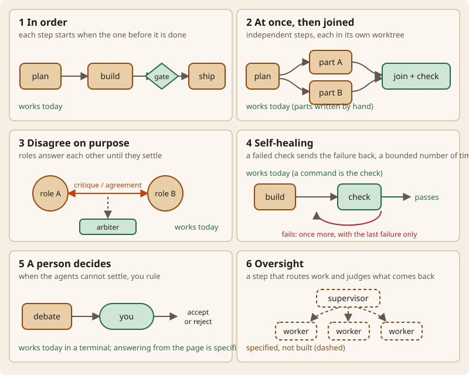

# Agent patterns: how to arrange agents in a workflow

People who build with several agents keep arriving at the same few arrangements. This page names them, shows what each
looks like as an Indaba workflow, and says plainly which ones work today, which work in part, and which are only
specified. Indaba does not add a pattern of its own to any of them: it runs the arrangement you write as a workflow,
keeps the agents inside the files they may change, and traces what happened.

The list was prompted by a widely shared infographic of agent design patterns by Dr. Maryam Miradi. The grouping, the
wording and the diagram here are this page's own, and they follow what Indaba's workflow file can express, not the
other way round.



## Where each pattern stands

| Pattern | What it means | In Indaba | State |
| :--- | :--- | :--- | :--- |
| Sequential pipeline | Each agent hands its result to the next | `depends_on` between steps | Works (alpha) |
| Plan, then execute | One step writes the plan, later steps carry it out | a planning step with `outputs`, then the work steps with `input_artifacts` | Works (alpha) |
| Parallel work, then join | Independent parts built at the same time, then merged and checked | steps with the same `depends_on` and `isolation: git_worktree`, a limit above 1, one step that depends on all of them | Works (alpha); not yet reviewed before landing |
| Debate | Roles argue until they agree | `consensus_with` and `decision_type` | Works (alpha) |
| Adversarial, with a judge | Opposing positions, and someone rules | a debate with an `arbiter`: `human`, or one a plugin registers | Works (alpha) |
| Self-healing | A check fails, the agent is told what failed and tries again with a corrected approach | a `shell` step and `on_failure` with `retry_step`; the next prompt carries the last failure | Works (alpha) |
| Recover from a stall or a runner that cannot start | A silent step is run again, or another runner takes over | `stall`, and a list of runners in `runner` | Works (alpha) |
| Human in the loop | A person decides at a chosen point | the `human` arbiter, and the decision ledger | In part: answering from the page and an "ask" level are specified |
| Orchestrator and workers | One step splits the goal and others do the parts | a planning step, and worker steps you write by hand | In part: steps made from the plan are specified (`step-fanout`) |
| Map and reduce | The same job on many items, then one summary | the map half needs `step-fanout`; the reduce half is a step that depends on the others and reads the board | Specified |
| Evaluator and optimizer | One agent writes, another scores, repeat until good enough | a command can be the evaluator today; an agent that returns a verdict is specified (`step-verdicts`, `review-gate`) | In part |
| Supervisor and hierarchy | A step routes work, judges the results, may itself be supervised | guards and gate steps cover the checking; a role that owns part of the project is specified (`path-ownership`) | Specified |
| Reflection, tool use, ReAct | One agent reviews its own output, or picks a tool, or reasons between actions | inside the agent, not in the engine; Indaba limits the tools with `permissions` and `mcp` | Not Indaba's layer |

"Specified" means a written specification exists and nothing is built; [positioning.md](positioning.md) lists the same
state for every part of Indaba, and [roadmap.md](roadmap.md) says in which order they are built.

## In order, and plan first

The simplest arrangement is a line: each step names the one before it in `depends_on` and starts when that one is done.
Put a check between two steps and a bad result stops there instead of travelling on. "Plan, then execute" is this
arrangement with one rule added: the planning step may write only its plan. A `git_diff_empty` guard on the planning step
fails it if it changed any code.

```yaml
steps:
  - id: "plan"
    role: "planner"
    goal: "Write the plan to ${{ artifacts.plan }}."
    outputs: ["${{ artifacts.plan }}"]
    guards:
      - type: "git_diff_empty"
        paths: ["src/", "tests/"]

  - id: "build"
    depends_on: ["plan"]
    role: "builder"
    input_artifacts: ["${{ artifacts.plan }}"]
    goal: "Carry out the plan."
    isolation: "git_worktree"
```

[`examples/task-pipeline.workflow.ai.yml`](../examples/task-pipeline.workflow.ai.yml) is this line with a test step and a
review debate after it. Steps can also leave each other short notes on the run board
([workflow-format.md](workflow-format.md#the-board-notes-between-steps)), which is how a later step reads what an earlier one found without a
file name between them.

## At once, then joined

Two steps that do not depend on each other can run at the same time. Each works in a worktree of its own, says first what
it intends to change, and, if its intention meets another step's, waits or agrees a contract with it. Their changes land
one at a time, and a collision is settled by the agents. A last step that depends on all of them checks the joined result.

Three things to know before you rely on it:

- The limit of steps at once is 1 unless you raise it (`--parallel`, `INDABA_PARALLEL`, `indaba.config`, or `max_parallel`
  in the file, which can only lower it). Every run above 1 prints what it costs: an extra call per step, negotiation
  between steps that meet, a worktree each.
- Steps that work in the project directory run alone; only worktree steps run together.
- There is no review before a change lands yet (`step-verdicts`), and this arrangement has not been run against a real
  agent inside this repository. Treat it as an alpha.

[`examples/parallel-modules.workflow.ai.yml`](../examples/parallel-modules.workflow.ai.yml) is a planner, two builders
that own separate directories, and a check. The two builder steps are written out by hand. Running one step once per item of a plan, so that a third
module needs no third step, is `step-fanout`, which is specified and not built. Until then a "map and reduce" is the
same file with as many map steps as there are items, and one step that depends on all of them.

## Disagree on purpose

A debate is a step with `consensus_with`. The roles answer each other on a shared blackboard for up to four rounds, and
only an `AGREEMENT` counts as approval. Used for review, it needs the care described in
[Pattern: a review debate](workflow-format.md#pattern-a-review-debate): `AGREEMENT` must mean "I accept the other
reviewers' findings", or reviewers who agree with each other still end the debate without consensus.

Two roles that start from opposed positions, and a third party who rules, is the same step with an `arbiter`. `human`
shows you the transcript and reads `accept` or `reject`; a plugin can register an adjudicator, which is how a model other
than the debaters can be the judge ([extending.md](extending.md)). Every ruling is appended to the decision ledger, which
you commit, and an identical question later reuses it. [`examples/review-debate.workflow.ai.yml`](../examples/review-debate.workflow.ai.yml)
is the smallest example.

## Self-healing: check, then try again

A failed step heals itself when the agent is told what went wrong and tries again. That works today. The check is a command. A `shell` step runs your tests, linter or type checker; the first command that
exits non-zero fails the step, and `on_failure` can send the run back:

```yaml
- id: "verify"
  depends_on: ["build"]
  runner: "shell"
  commands: ["pnpm test", "pnpm typecheck"]
  on_failure:
    action: "retry_step"
    target: "build"
    max_retries: 3
```

The target and every step after it are reset and run again, and the target's next prompt carries the failure of the last
attempt (the end of the command output), so the agent can diagnose the error and change its approach. Two rules keep a loop
from running away: it is bounded by `max_retries`, and each retry's prompt carries only the last failure, never the whole
history of failed ones. The same family covers a silent step (`stall` stops an attempt that shows no activity and runs it again) and a
runner that cannot start (a list in `runner` tries the next one, but never after a runner that started and failed, because
it may already have changed files).

An agent as the evaluator, one that reads the work and returns a verdict the engine acts on, is `step-verdicts` and
`review-gate`, both specified. Until then, an agent's review is a debate or a note on the board, and a person or a command
turns it into a pass or a fail.

## A person decides

A human arbiter is the human-in-the-loop step that exists today, and it needs a terminal: with no terminal the step
escalates as it would without an arbiter. Answering an agent's question from the web view, and an `ask` permission level
that stops before an action, are specified (`question-contract`, `agent-conversation`) and not built; a `permissions`
block with `level: ask` is rejected today.

## Oversight

A supervisor routes work to specialists and judges what comes back, and a hierarchy stacks supervisors. Indaba has the
parts that do the judging, which are guards, gate steps and debates, but no step that creates other steps or hands work
to a named owner. A role that owns part of the project, with other agents asking it for changes instead of making them, is
`path-ownership`, specified.

## Inside one agent

Reflection (an agent re-reading its own output), tool use and the alternation of thinking and acting are properties of an
agent, not of the engine that runs it, and Indaba does not reimplement them. It governs the edges: which tools an agent may
use (`permissions`, `mcp`), which files it may change, how long it may take, and how many times it may be retried. If
you want reflection as a visible step, write it as a pair of roles: one produces, the other critiques in a debate, and the
transcript is in the trace.

## Choosing

- Start with a line and a command that checks. Most work needs nothing more.
- Add a second agent when a mistake would be costly and a command cannot catch it: a debate, with a human arbiter if the stakes justify the wait.
- Add parallel steps only when the parts really do not share files, and read what it costs first.
- When you want one of the "specified" arrangements, the nearest working one is usually the same file with the steps written out by hand.

Each of these is a different answer to the same question: who decides that the work is good, an order, a command, another
agent or a person. The workflow file is where you write that answer down.
