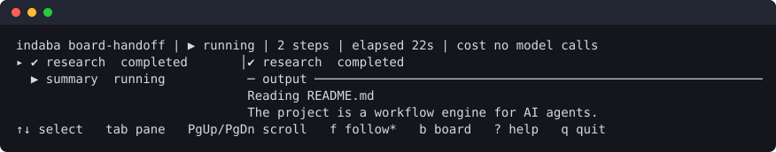
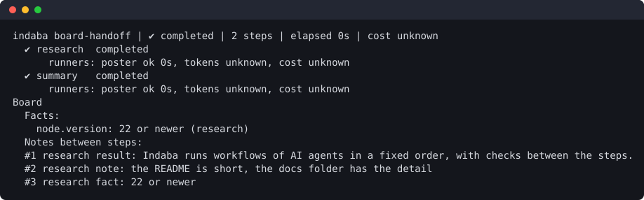
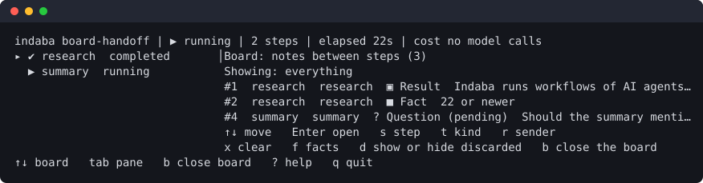
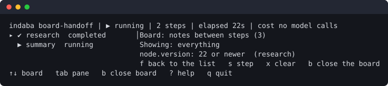
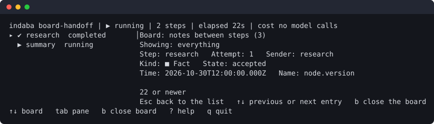

# Playbook

Recipes for working with Indaba, one way of working at a time. Each one says when to use it, the commands, what you
should see, and what to do when you do not. The reference for every option is [Getting started](getting-started.md); the
workflow file is in [Workflow format](workflow-format.md).

The examples below use [`examples/board-handoff.workflow.ai.yml`](../examples/board-handoff.workflow.ai.yml): two
steps where the second reads what the first learned. Replace `indaba` with `npx indaba` if you have not installed it.

| I want to | Go to |
| :--- | :--- |
| check a file before I spend anything | [Check a workflow](#check-a-workflow) |
| see what a run will do and what each step may share | [Plan a run](#plan-a-run) |
| run a workflow and read the result | [Run it](#run-it) |
| watch a run in the terminal, live or later | [Watch a run](#watch-a-run) |
| read what the steps told each other | [Reading the board](#reading-the-board) |
| have two agents argue until they agree | [A debate](#a-debate) |
| watch in a browser | [The web view](#the-web-view) |
| find out why a run failed | [When a run fails](#when-a-run-fails) |
| script Indaba or run it in CI | [In a script or in CI](#in-a-script-or-in-ci) |

## Check a workflow

**Use it** every time you edit a file, and before the first run.

```bash
indaba validate examples/board-handoff.workflow.ai.yml
```

You should see `board-handoff is valid (2 steps, 2 roles).` and exit status 0. A problem is printed with the path of the
field (`steps[1].board.read.steps[0] "nowhere" is not a step`) and the status is 1. Fix the first one and run it again:
a file with a broken field is reported in one go, and problems that depend on the whole workflow (a step that is not an
ancestor, a cycle) appear once the fields themselves are sound. `validate` starts nothing and costs nothing.

## Plan a run

**Use it** to see the order of the steps, who runs each, and what each one reads from and may post to the board.

```bash
indaba plan examples/board-handoff.workflow.ai.yml
```


A step with no board line neither reads nor posts. `reads nothing; may post result, fact` is a step that leaves notes but
takes none; `reads research (result, fact), at most 4000 characters` is a step that gets a section of notes added to its
prompt. If a line is not what you meant, fix the `board:` field before you run.

## Run it

**Use it** when the file validates. This starts the agents, so it costs what they cost.

```bash
indaba run examples/board-handoff.workflow.ai.yml
```

Each step's changes `PENDING -> RUNNING -> VALIDATING -> COMPLETED` are printed, and the last line gives the task, its
final state and the trace id:

```text
Task demo finished: COMPLETED (trace 9ad25c8a0001ea4000c2056f6acd2bf7)
```

The exit status is 0 when it completed, 1 when it failed, 2 when a human is needed (a debate no one could settle) and 130
when it was cancelled. Useful options: `-w <dir>` runs it against another project, `--timeout <secs>` limits a step,
`-v` prints what each span cost and `-vv` also streams the agents' output, `--permissions read` lowers what agents may do
for this run only.

What a run leaves behind is under `.indaba/` in the project: `traces/<id>.jsonl` (the spans), `traces/<id>.events.jsonl`
(what `watch` reads), `traces/<id>.board.jsonl` (the board), `logs/` and, for debates, `discussions/`.

## Watch a run

`watch` only reads those files, so you can start it before, during or long after the run, from a second terminal, and
it never touches the run.

```bash
indaba watch                    # the runs, newest first
indaba watch latest             # follow the newest, or read it if it has finished
indaba watch latest --replay    # play a finished run back with its original timing (--speed 10 is ten times faster)
indaba watch latest --plain     # lines, not the dashboard
```

**The dashboard** opens on a terminal when `@indaba/tui` is installed (`npm install @indaba/tui`). The steps are on the
left and the output of the selected one on the right; below 80 columns they stack.



| Key | Does |
| :--- | :--- |
| `↑` `↓` or `j` `k` | select a step (or scroll, once you press `tab`) |
| `g` `G` | first or last step |
| `PgUp` `PgDn` | scroll the output |
| `f` | follow the newest output |
| `tab` | move the arrow keys to the other pane |
| `b` | open or close the board |
| `?` | list the keys |
| `q` | quit (it asks what to do with a run it started) |

States are a symbol and a word, never colour alone. `--ascii` avoids box and arrow characters and `NO_COLOR` turns colour
off.

**Plain output** is what you get with `--plain`, without a terminal, and in a pipe. It ends with the board when the run
has one, and the exit status is the run's: 0, 1, 2, 130, or 3 when the files end without a final state.



**Start and watch in one go** with `indaba run <file> --tui`. Quitting the dashboard asks whether to detach (the run goes
on and `indaba watch <run>` picks it up again), cancel it, or stay.

## Reading the board

**Use it** to see what the steps told each other, while a run goes or afterwards. Press `b` in the dashboard.



Each line is `#number  step  sender  kind  text`. The kind is a word and a symbol: Note, Question, Result, Fact, Decision,
and for a debate Proposal, Critique and Agreement. An entry whose step is still running is marked `(pending)`: you can
read a step's notes while it works, but the next step will not see them until the step has completed. Entries that were
thrown away because their step failed (`discarded`), or replaced because a retry started over (`replaced`), are hidden;
`d` shows them.

| Key | Does |
| :--- | :--- |
| `↑` `↓` `j` `k` | move; `g` `G` jump to the first or last entry; `PgUp` `PgDn` page |
| `Enter` | open the entry in full; `Esc` goes back |
| `s` | only the step selected in the step list; press again to clear |
| `t` | cycle the kind: each kind that is on the board, then all |
| `r` | cycle the sender |
| `x` | clear every filter |
| `f` | the facts: the current value of each, and the step that set it |
| `d` | show or hide discarded and replaced entries |
| `b` or `Esc` | close the board |

Which keys apply depends on where the arrow keys are: after `b` they are on the board, and `tab` moves them back to the
step list. That is why `f` follows the output in the step list and shows the facts on the board.





The pane says what it cannot show: **No board file yet** (the run has not written to it), **There is no board for this
run**, **The board is incomplete** (part of it could not be saved, so some notes are missing), **The board reached its size
limit** (later notes were not kept) and how many lines of the file could not be read. Without a terminal, `watch --plain`
gives the same content as lines. The file itself is `.indaba/traces/<id>.board.jsonl` if you want to read it with
another tool; its format is in [specs/run-blackboard/data-model.md](../specs/run-blackboard/data-model.md).

**To make steps share notes**, write a `board:` field on both sides, as in
[The board](workflow-format.md#the-board-notes-between-steps), and tell the first agent in its goal to end with `BOARD ...`
lines. If the second step does not seem to get them, work down this list: `indaba plan` shows `reads` on the second step
and `may post` on the first; the first step completed (a failed step's notes are discarded); the second step depends on the
first, directly or not; the agent's lines start at the very first character of a line and are outside a code fence; and
`indaba watch latest --plain` lists the notes. The span of the first step counts `indaba.board.posted` and
`indaba.board.ignored`.

## A debate

**Use it** when you want two or more agents to challenge each other, as in a review.

```yaml
steps:
  - id: review
    role: claude
    consensus_with: [antigravity]
    decision_type: consensus
    arbiter: human
    goal: ...
```

Run it as above. Nothing else is needed to see it on the board: the messages appear as Proposal, Critique and Agreement
with the round, followed by one Result (`stalled after 2 round(s). Open objections: ...`, or the agreement) and, when a
person or an arbiter ruled, a Decision. Open the board with `b` and use `t` to look at the critiques only. The full
transcript and the rulings are kept as before; see [Workflow format](workflow-format.md#consensus-steps). A step after
the debate can read all of this with `board: { read: {} }`, even when the debate ended without agreement.

## The web view

**Use it** when you prefer a browser, or to edit workflows as a form or a graph.

```bash
indaba ui
```

It prints a local address with a token and keeps running until you stop it; runs, workflows, editing and the logging
settings are in [The web view](web-view.md). The page does not show the board yet; the dashboard and `watch --plain` do.

## When a run fails

1. `indaba watch latest --plain` shows which step failed, its reason, and the board.
2. `indaba watch latest --replay --speed 10` plays it back; add `--output` to see what each step printed.
3. `indaba report latest` gathers the log, trace and environment into a folder to attach to an issue. Secrets are
   removed from it.
4. The logs are in `.indaba/logs/`; [Logging](logging.md) says how to change the level and where they go.

A step that failed has its notes discarded, so the steps after it do not read them. A retry starts from a clean board
for the steps it resets and carries only the last failure.

## In a script or in CI

```bash
indaba validate flow.workflow.ai.yml && indaba run flow.workflow.ai.yml -w "$PWD" --timeout 600
echo $?
```

Everything is arguments and exit statuses: 0 completed, 1 failed, 2 escalated, 130 cancelled. A step at permission level
`full` needs a terminal to ask at, or `--allow-full-access` when there is none. Keep keys in the environment
(`OPENROUTER_API_KEY` and the like) and never in the workflow file. `indaba schema` prints the JSON Schema of the file for
an editor, and `indaba catalog` lists the runners, guard types and arbiters this installation offers.

## Where to go next

- [Workflow format](workflow-format.md) for every field
- [Extending](extending.md) to add a runner, a guard or a listener
- [Logging](logging.md) when something needs finding
