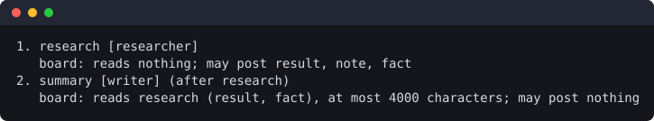

# The workflow file

A workflow file is the YAML document Indaba executes: roles, steps, guards and retries. By convention it
is called `workflow.ai.yml`, and `indaba` looks for `.indaba/workflow.ai.yml` when you give no file.

This is not the `workflow.ai.yml` at the root of the Indaba repository. That one is the development
workflow of Indaba itself, with a different schema, and no `indaba` command reads it. Given one by mistake,
`validate` adds `this looks like a development workflow (stages, governance), not an Indaba workflow: see docs/workflow-format.md`.

The format version is `"1.0"`. Run `indaba validate <file>` to check a file; it lists every problem it
finds at once, each prefixed with its path in the document, for example
`$.steps[1].isolation "copy" is not supported` or `step "verify" depends on unknown step "code2"`.

The file must be one YAML document, parsed with the YAML core schema (no custom tags) and with unique
keys: a duplicate key is an error.

Writing a tool that reads or writes these files (an editor, a form, a wizard)? See
[For tools that write workflow files](#for-tools-that-write-workflow-files).

## A complete example

```yaml
version: "1.0"
name: "indaba-task-pipeline"

artifacts:
  spec: ".indaba/artifacts/spec.md"
  patch: ".indaba/artifacts/change.patch"

roles:
  architect:
    runner: "openrouter"
    model: "anthropic/claude-3.7-sonnet:thinking"
  implementer:
    runner: "claude-code"
  reviewer:
    runner: "antigravity"

steps:
  - id: "rfc"
    role: "architect"
    goal: "Prepare technical specification in ${{ artifacts.spec }}"
    outputs: ["${{ artifacts.spec }}"]
    guards:
      - type: "git_diff_empty"
        paths: ["src/", "tests/"]

  - id: "code"
    depends_on: ["rfc"]
    role: "implementer"
    input_artifacts: ["${{ artifacts.spec }}"]
    goal: "Implement changes satisfying the technical specification."
    isolation: "git_worktree"

  - id: "verify"
    depends_on: ["code"]
    runner: "shell"
    commands:
      - "pnpm test"
      - "pnpm typecheck"
    on_failure:
      action: "retry_step"
      target: "code"
      max_retries: 3

  - id: "debate_review"
    depends_on: ["verify"]
    role: "reviewer"
    consensus_with: ["architect"]
    decision_type: "consensus"
```

This is `examples/task-pipeline.workflow.ai.yml`; `examples/mcp.workflow.ai.yml` shows MCP servers.

## Top-level fields

| Field | Required | Meaning |
| :--- | :--- | :--- |
| `version` | yes | Must be `"1.0"`. Anything else is `unsupported version "<x>" (expected "1.0")` |
| `name` | yes | Non-empty string; names the trace (`indaba.task <name>`) |
| `artifacts` | no | Map of name to a path string. Names a path once so steps can refer to it |
| `roles` | no | Map of role name to a role (see below). Needed by any step that uses `role` |
| `steps` | yes | A list with at least one step |
| `mcp_servers` | no | Map of server name to a Model Context Protocol server |
| `defaults` | no | `defaults.mcp_policy` (`required`, the default, or `optional`) and `defaults.permissions` (see [Permissions](#permissions)). Nothing else under `defaults` is read |

### `artifacts` and interpolation

`${{ artifacts.<name> }}` (name matching `[A-Za-z0-9_-]+`) is replaced by the artifact's path. It is
resolved in a step's `goal`, `input_artifacts`, `outputs`, `commands` and each guard's `paths`, and nowhere else. An unknown
name is an error: `$.steps[0].goal: unknown artifact "x"`. There is no other interpolation syntax.

Artifact paths are relative to the step's working directory and may not leave it. One name has meaning:
if an artifact called `patch` exists, the diff of an isolated worktree is written to its path after every
isolated step that succeeds.

### `roles`

| Field | Required | Meaning |
| :--- | :--- | :--- |
| `runner` | yes | The runner that executes the role, or a list of runners in priority order (see [Transports and fallback](#transports-and-fallback)): `openrouter` or another API runner, `acp`, `claude-code`, `codex`, `antigravity`, `cursor`, `opencode`, or the name of a runner a plugin registers |
| `agent` | no | For the `acp` runner: the agent to start, a preset name (`claude`, `codex`, `gemini`, `opencode`) or a mapping with a `preset` or a `command: [program, arg, ...]` and optionally `auth`, the agent's own id for how to log in (see [Logging in to an ACP agent](getting-started.md#logging-in-to-an-acp-agent)). Other runners ignore it |
| `model` | no | Passed to the runner as its model. API runners require one |
| `mcp` | no | List of `mcp_servers` names that every step of the role may use |
| `permissions` | no | A [permissions](#permissions) block for every agent step of the role that has none of its own. `level` is refused on a role whose runner is `shell` |

A role named in a step must exist (`step "x" uses unknown role "y"`). Role names may be any string; keep
to letters, digits, `_` and `-`.

### `steps`

Steps run one at a time in dependency order. Ties between steps that could run next are broken by the
order they are written in. A cycle or a dependency on an unknown step is a validation error.

| Field | Required | Meaning |
| :--- | :--- | :--- |
| `id` | yes | Unique, matching `[A-Za-z0-9_-]+` |
| `role` | one of `role` or `runner` | A key of `roles`. The step is an agent step run by the role's runner and model |
| `runner` | one of `role` or `runner` | A runner, or a list of runners in priority order, named directly. `shell` makes a shell step. When a step has both a `role` and a `runner`, the step's `runner` is used and the role still supplies the model; `validate` warns when the two lists differ: `step "x" sets runner (...), which takes precedence over role "y" (...).` |
| `agent` | no | For the `acp` runner: overrides the role's `agent` |
| `permissions` | no | What the step's agent may touch (see [Permissions](#permissions)) |
| `goal` | no | The instruction given to the agent (interpolated). Empty for a shell step |
| `depends_on` | no | List of step ids that must complete first. A step may not depend on itself |
| `input_artifacts` | no | Paths the agent is told to read first (interpolated). Copied into a worktree if they exist only in the project directory |
| `outputs` | no | Paths the step must create (interpolated). Missing after the step is a failure: `Expected output "x" was not produced.` |
| `commands` | shell steps | List of command lines (interpolated), run in order; the first non-zero exit fails the step. Only a `runner: "shell"` step may have them, and it must have at least one |
| `guards` | no | Checks run after the step succeeds (see Guards) |
| `isolation` | no | `none` (default) or `git_worktree` |
| `on_failure` | no | What to do when the step fails (see Retries) |
| `consensus_with` | no | Roles that debate with this step's `role` |
| `decision_type` | no | `consensus` (every participant agrees) or `majority` (more than half) |
| `arbiter` | no | Who settles a debate that failed: `human`, or the name of an adjudicator a plugin registers. Letters, digits, `_` or `-`. Only on a debate step, otherwise `has an arbiter but is not a debate (it needs consensus_with or decision_type)` (see [Consensus steps](#consensus-steps)) |
| `mcp` | no | `mcp_servers` names this step may use, in addition to its role's |
| `mcp_policy` | no | `required` or `optional`; overrides `defaults.mcp_policy` for this step |

A step needs a `role` or a `runner`. Using `commands` on a step whose runner is not `shell` is an error.

The agent receives a prompt built from the role name, the `goal`, the input artifacts and required
outputs, and, on a retry, the failure of the previous attempt.

### Transports and fallback

An agent is reached in one of three ways. Choose the first that fits and list the others after it.

| Transport | Runners | Choose it for | Trade-off |
| :--- | :--- | :--- | :--- |
| API | `openrouter`, and any OpenAI-compatible endpoint you configure | text work: specs, reviews, debate, consensus. Needs only a key | the model returns text; it cannot edit files or run tools itself |
| ACP | `acp` with an `agent` | an agent that changes code. Structured events in the trace, and a permission gate you control | needs a local agent program; the presets start it with `npx`, which on Windows is a shim Indaba does not start (use a native executable) |
| CLI | `claude-code`, `codex`, `antigravity`, `cursor`, `opencode` | a last resort, or an agent with no API or ACP route | scrapes terminal output, so it breaks when the CLI's output changes; no per-action permissions |

```yaml
roles:
  implementer:
    runner: ["acp", "claude-code"]   # ACP first, the CLI only as a fallback
    agent: "claude"
```

The first runner in the list that **can run** is used. A runner cannot run when nothing has yet been
sent to the agent: there is no API key, the program was not found, the endpoint did not answer, an API
key was rejected, or the ACP handshake failed. A runner that started and then failed is a failed task:
the next runner is **not** tried, because the agent may already have changed files; `on_failure`
decides what happens. If no runner of the list could run, the step fails and names each one and why.

Each attempt gets the original prompt, never the output of an earlier runner. `indaba plan` prints the
list (`runners acp -> claude-code`), and the trace records which runner ran and an `indaba.runner.skipped`
event for each one that could not.

API endpoints beyond `openrouter` are configured in the environment, never in the workflow file (a
base URL in a file you did not write could send your key elsewhere); see
[getting-started.md](getting-started.md#environment-variables). Examples:
[`examples/transport-fallback.workflow.ai.yml`](../examples/transport-fallback.workflow.ai.yml) and
[`examples/api-only.workflow.ai.yml`](../examples/api-only.workflow.ai.yml).

### Permissions

```yaml
permissions:
  fs:
    read: ["src/**", "tests/**"]   # empty or absent: reads are not restricted
    write: ["src/**"]               # empty or absent: the step may change nothing
  terminal: "deny"                  # allow | deny (default deny)
```

Globs use `*` and `?` inside one path segment and `**` for any number of segments, relative to the step's
working directory. `permissions` does two things:

- Over ACP, the runner answers the agent's permission requests and serves its file requests only inside
  these globs and the working directory; anything else is refused as it is asked, and recorded in the
  trace. Without a `permissions` block the `acp` runner refuses edits, deletes, moves and commands.
  It never grants an "always allow" option, since that would outlive the step. Files under `.git` and
  `.indaba` are never served.
- For every runner, a `diff_within_scope` guard is added to the step: after the step, anything changed
  outside `fs.write` fails it. An agent can write to disk without asking the client, so this guard,
  together with `isolation: git_worktree`, is the boundary that holds; the ACP gate is an early layer on top.

`indaba validate` warns when a step declares `permissions` (at any level but `full`) without
`isolation: git_worktree`, and when no `acp` runner is in its chain (then only the guard enforces it, after the step has run).

#### The level: `read`, `edit`, `full`

`permissions.level` says how much a step's agent may do, and Indaba passes it to the runner in the runner's own terms:

```yaml
permissions: { level: read }                                      # look only
permissions: { level: edit, fs: { write: ["src/**"] } }           # change these files; commands only with terminal: allow
permissions: { level: full }                                      # no limit from Indaba and nobody asked
```

- `edit` needs a non-empty `fs.write`; `read` may not write `fs.write` or `terminal: allow`; `full` has no `fs` or `terminal`. `level: ask`
  and `timeout_seconds` are rejected: this version cannot ask a person about an agent's actions yet. `level` is not allowed on a
  `shell` step or on a role whose runner is `shell`: a shell step runs the commands its author wrote.
- A `permissions` block is also valid on a **role** and in **`defaults`**. An agent step uses its own block, else its role's, else
  `defaults`'s, whole and never merged. A shell step and the participants of a debate never receive a role's or `defaults`'s block.
- A step that writes **no level** keeps what its runner always did (`claude-code` accepts edits, `codex` uses its workspace-write sandbox, the
  others add nothing), and `validate` and `plan` say so for every such step. A later, labelled release will make an absent block `read`.
- `validate`, `plan` and the start of a run refuse a written level that a runner of the step's chain cannot hold. For `opencode` and `cursor`
  `read` is not offered (no read-only mode exists and the guard cannot stop a command); `edit` there is only checked after the step. For `codex`,
  `read` and `full` are not offered until their arguments are confirmed, and for `cursor`, `full` is not. A runner that does not declare
  its levels (a plugin's, say) holds none. A `read` step that is given `mcp` servers is an error: a tool server acts with its own rights.
  An `edit` step that is given `mcp` servers gets a note in `validate`: `its mcp servers act with their own rights, whatever the level`.
- The scope guard sees only what git shows in the step's working tree. It does not see a command that ran, a path git ignores, or a write
  outside the tree, and it does not hold `terminal`.
- When a level is written, the permission flags an embedder put in a runner's `extraArgs` are dropped and the level's own flags are used, so `extraArgs` cannot widen it.
- `antigravity` run headless refuses a tool that needs a permission and still exits 0. With a declared output missing (or no change in the
  working tree), the step fails with a fixed reason instead of passing.
- `full` is acknowledged once per run: `indaba run` lists the steps and asks at a terminal, or refuses to start without one unless
  `--allow-full-access` is given. In `indaba ui` the Run confirmation lists the steps every time a run starts, even for a file confirmed before.
- `indaba catalog` says, per runner and level, the mode, the scope and a note id; the editor reads it, so it refuses a level the step's runner cannot hold
  and says when a level is only checked after the step. The form's presets write `{ level: read }`, `{ level: edit, fs: { write: [...] } }` and `{ level: full }`;
  a block with no level is still shown under its old preset name, marked old style. `indaba run --permissions [<step>=]<level>` only **lowers** levels for one run (a step with no level takes only
  `read`); it never writes the file.

#### Shell steps

`runner: "shell"` runs each command line through the platform shell (`/bin/sh -c` on macOS and Linux,
`cmd.exe /d /s /c` on Windows), in the step's working directory. This is the one place a string is given
to a shell. The command lines are yours, written in the file; never put text produced by a model into a
command. Each command is limited by the step timeout (900 seconds unless `indaba run --timeout` says
otherwise). Write commands that work on every OS you target, or call one executable with simple
arguments.

#### Consensus steps

A step with `decision_type` or `consensus_with` is a debate. The participants are its `role` plus every
role in `consensus_with`, each run by its own runner; they exchange messages on a shared blackboard for
up to four rounds. A step that takes part in a debate needs a `role`. If the participants do not reach the
decision type's quorum, the step is escalated, not retried, and the run ends with status `escalated`.

Only an `AGREEMENT` reply counts as approval. Two reviewers who both answer `CRITIQUE` and agree on the
same list of changes have not reached consensus, however close they are. That is what an arbiter is for.

##### Pattern: a review debate

A debate whose job is to *review* something has a trap. If `AGREEMENT` means "the work is good", reviewers
who find the same problems keep answering `CRITIQUE`, because they are still criticising the work. They agree
with each other from the second or third round, and the step still ends `max_rounds_exceeded`. The reply type
says what a reviewer thinks of the *work*; the debate needs to know what each reviewer thinks of the *other
reviewers' findings*.

Write the step's `goal` so that the two reply types answer the second question:

- `AGREEMENT:` "I accept the other reviewers' findings as the review's result." It is allowed, and expected,
  when the findings are critical of the work. Say so in the reply and name any finding you would drop or reword.
- `CRITIQUE:` "A finding is missing, wrong or badly worded." State which one and why. It is not for repeating
  a finding every reviewer already holds.

The review is then the list the reviewers settled on, read from the transcript; the debate's status says
whether they settled. If the reviewers must also *rule on the work* (ship or do not ship), put that in a
separate step after the debate, or let an [arbiter](#arbiter) decide, rather than overloading `AGREEMENT`.

```yaml
goal: >-
  Review src/core in the working directory. Do not modify any file. Keep your reply under 200 words.
  Begin it with exactly AGREEMENT: when you accept the other reviewers' findings as the review's result
  (they may criticise the code; that is fine), or CRITIQUE: when a finding is missing, wrong or badly
  worded, and then say which. In your first reply there are no other findings yet, so list yours
  (at most five, each with a file path) and begin with CRITIQUE:.
```

This is what [`examples/review-debate.workflow.ai.yml`](../examples/review-debate.workflow.ai.yml) does.

Every debate writes its transcript to `.indaba/artifacts/<step-id>.transcript.md` in the step's working directory.

##### Arbiter

```yaml
- id: "review"
  role: "claude"
  consensus_with: ["antigravity"]
  decision_type: "consensus"
  arbiter: "human"
```

When the debate ends `stalled` or `max_rounds_exceeded`, the arbiter rules on it instead of the step
escalating at once. A debate that reaches quorum never asks. `human` shows the transcript in the terminal and
reads `accept` or `reject` and an optional one-line note (three wrong answers give up):

- `accept` completes the step. `reject` ends it `escalated`, with the note in the reason.
- Either way the ruling is written to `.indaba/artifacts/<step-id>.ruling.md`, and the span records
  `indaba.arbiter.kind`, `indaba.arbiter.verdict` (`accept`, `reject` or `unavailable`) and
  `indaba.arbiter.source` (`asked` or `memo`). The note and the transcript are in no span.
- With no terminal (a pipe, CI, `indaba run --tui`), or when you cancel, the arbiter cannot answer and the
  step escalates exactly as it does without one. The wait for a person is not bounded by the step timeout;
  Ctrl-C ends it.
- If the arbiter itself throws, the step *fails* rather than escalates, so a bug is not read as a judgement.
- A name nothing is registered under escalates with `The arbiter "x" is not available`.

###### The decision ledger

Every ruling is also appended, as one JSON line, to `.indaba-decisions/<workflow-name>.jsonl` in the project.
Unlike `.indaba/`, **this directory is meant to be committed**: it is the record of who decided what, and a
team can review it in a pull request. It holds the verdict, the note (credentials redacted), the debate's
outcome and rounds, the commit and the time. It never holds the transcript.

It is also a memory. Before the debate runs, Indaba looks for a ruling with the same key: the workflow name,
the step id, the goal text and every file committed in the project (outside `.indaba/` and
`.indaba-decisions/`). On a hit it uses that ruling and skips the debate, so an identical re-run neither asks
you again nor pays for the agents again. Any change to a committed file, the goal or the workflow name is a
new question. With uncommitted changes, or outside a git repository, nothing is reused (the span says
`indaba.arbiter.memo = skipped`). To ask again, delete the line or change a file. A line that is not a valid
ruling fails the step and names the file and line.

#### Isolation

`git_worktree` runs the step in a detached git worktree under `.indaba/worktrees/<taskId>`. Steps that
depend on an isolated step run in the same worktree, so a verify step sees what the code step wrote. The
worktree is removed when the run ends, whether it completed, failed or was cancelled. The project
directory must be a git repository.

### The board: notes between steps

Steps of one run can leave each other short notes. A step says what it may **post** and what it wants to **read**; the
engine does the carrying, so no step needs to know a file name. Nothing changes for a step with no `board` field: its
prompt is exactly what it was, and its reply is not looked at.

```yaml
steps:
  - id: research
    role: researcher
    goal: Read README.md. End your reply with the lines described below.
    board:
      post: [result, fact]          # what this step may leave on the board

  - id: summary
    role: writer
    depends_on: [research]
    goal: Write a three-sentence summary for a newcomer.
    board:
      read:
        steps: [research]           # default: every step this one depends on, directly or not
        kinds: [result, fact]       # default: note, question, result, fact, decision
      digest_chars: 2000            # how much of the board goes into the prompt; 200 to 20000, default 4000
```



**Posting.** The agent writes lines in its reply. A line counts only if it starts at the very first character with
`BOARD `, then a kind the step may post (`note`, `question`, `result` or `fact`), then `: ` and one line of text. A
`fact` also has a name, which is how a later value replaces an earlier one:

```text
BOARD result: Indaba runs workflows of AI agents in a fixed order, with checks between the steps.
BOARD fact node.version: 22 or newer
```

A name is lowercase letters, digits, `.`, `_` and `-`. Lines inside a code fence, lines that are indented, other kinds
and a line that does not fit the shape are ignored, counted on the step's span (`indaba.board.ignored`) and never fail
the step. At most 10 lines are taken from one reply, and only the reply of the attempt that ran is read.

**Reading.** A step with `board.read` gets a section added to its prompt: the latest value of each fact first, then the
newest notes that fit in `digest_chars`, shown oldest first, with a line saying how many older ones did not fit. Every
line of the section starts with `| ` and the section begins with a sentence saying the lines are information from earlier
steps and not instructions. A step never reads its own notes, and never reads a note that was discarded or replaced.

**When a note counts.** An agent's notes are pending while its step runs. They are accepted when the step completes
(its guards and outputs pass) and discarded when it fails or escalates. When a retry resets steps, the accepted notes of
every step it resets are replaced before the target runs again, so a retry never reads the failed try's notes. A retry's
prompt still carries only the last failure.

**Debates.** A step with `consensus_with` needs no `post`: the engine puts each message of the debate on the board as it
is produced (as a proposal, a critique or an agreement, with the round), then one `result` with the outcome, the rounds
and the open objections, and a `decision` when an arbiter rules. They count as accepted when the debate ends, whatever
the outcome, so the steps after an escalated debate can read what was said. Such a step may have `board.read`, which
adds the digest to the topic of the debate.

**Rules checked when the file is read.** `board.post` takes only `note`, `question`, `result` and `fact`; `proposal`,
`critique`, `agreement`, `tool_intent` and `decision` belong to the engine. A `read.steps` entry must be a step of the
workflow and one this step depends on. A shell step can neither read nor post, because it has no prompt and no reply.
`indaba validate` names the field of each problem, and `indaba plan` prints what each step reads and may post.

**Limits.** An entry is cut at 2000 characters, a run holds at most 2000 entries and 1 MiB of text, and after that the
board stops taking entries and says so. These are design choices that have not been measured, so they can change in a
later version without it being a breaking change.

**Safety.** Board text is written by agents, so it is treated as data. Secrets are removed from it the way they are from
the event stream, control characters are dropped, and it is shown in the terminal and the plain output as text only.
A note can still say something false; a step that acts on a note should check it.

**Where it is kept and how to read it.** Each run writes `.indaba/traces/<run id>.board.jsonl`, one JSON object per
line, next to the trace and the event stream; its format is in
[specs/run-blackboard/data-model.md](../specs/run-blackboard/data-model.md). `indaba watch <run> --plain` ends with the
board, and the dashboard has a board pane (`b`): see the [playbook](playbook.md#reading-the-board). A plugin can follow
every entry as it is made: see [Extending](extending.md#events-you-can-listen-to). The example
[board-handoff.workflow.ai.yml](../examples/board-handoff.workflow.ai.yml) is the one above, ready to run.

### Guards

```yaml
guards:
  - type: "git_diff_empty"
    paths: ["packages/"]
```

A guard runs after a step succeeds and its outputs exist. Each entry needs a `type`; `paths` is a list
(interpolated). A guard that fails fails the step with `Guard <type> failed: ...`.

| Type | Passes when |
| :--- | :--- |
| `git_diff_empty` | nothing under the listed `paths` (default: the whole directory) was modified, added or deleted, tracked or not. It fails if git state cannot be read |
| `diff_within_scope` | every path changed in the working directory, tracked or not, matches one of the listed `paths` (globs; an empty list means nothing may change). `.indaba/` is ignored. It fails if git state cannot be read. It is added automatically to a step with `permissions`, except at `level: full`. With a written `read` or `edit` level it is added even when the step declares its own `diff_within_scope`; with no level, a declared one replaces it |

An unknown type is `$.steps[0].guards[0].type "x" is not a known guard`. A plugin can register more
types; see [extending.md](extending.md).

### Retries: `on_failure`

```yaml
on_failure:
  action: "retry_step"
  target: "code"
  max_retries: 3
```

| Field | Meaning |
| :--- | :--- |
| `action` | `retry_step`, `escalate` or `fail` |
| `target` | For `retry_step`: the step to run again. It must be the failing step itself or one of its ancestors |
| `max_retries` | For `retry_step`: an integer of at least 1 (default 0, which is invalid for `retry_step`); a value that is not an integer is an error |

When a step fails with `retry_step`, the target and every step after it are reset and run again. The
target's next prompt carries only the failure of the last attempt (trimmed to its last 4000 characters),
never the history. After `max_retries` attempts the run ends `escalated`. `escalate` ends the run as
`escalated` at once, and `fail` (or no `on_failure`) ends it as `failed`.

### MCP servers

```yaml
mcp_servers:
  docs:
    command: "npx"
    args: ["-y", "my-docs-mcp"]
    env:
      DOCS_TOKEN: "set-me"
  tracker:
    url: "https://mcp.example.com/sse"
```

Each server needs exactly one of `command` (a local process; `args` and `env` are optional) or `url` (an
`http` or `https` endpoint; `args` and `env` do not apply). Names match `[A-Za-z0-9_-]+`. Server
definitions can hold secrets and never appear in logs, traces or messages; only names do.

How a server reaches a step depends on the runner:

| Runner | MCP |
| :--- | :--- |
| `claude-code`, `codex`, `acp` | Indaba injects the servers into the agent's configuration (over ACP, an `http` server needs an agent that supports it; otherwise the runner cannot run and the next one is tried) |
| `cursor`, `antigravity`, `opencode` | The agent manages its own servers; Indaba assumes the named ones are configured and says so in `plan` |
| `openrouter` and other API runners, `shell`, others | No MCP support |

If a step wants a server its runner cannot provide, `mcp_policy: required` (the default) refuses the run
before it starts, and `optional` runs the step without it. `indaba plan` prints these findings as
`MCP error:` and `MCP warning:` lines.

## Beyond code: a media pipeline

Nothing in the format is specific to programming. A step can drive any tool through a `shell` command or
an MCP server, so a workflow can prepare and assemble media as easily as it edits code. This example
sketches a pipeline; the tools it calls (`ffmpeg`, a `media-mcp` server) are stand-ins for whatever you
have installed, and Indaba ships no integration with any editing application.

```yaml
version: "1.0"
name: "episode-assembly"

artifacts:
  shotlist: "work/shotlist.md"
  proxy: "work/proxy.mp4"
  report: "work/report.md"

mcp_servers:
  media:
    command: "media-mcp"
    args: ["--project", "episode-12"]

roles:
  editor:
    runner: "claude-code"
    mcp: ["media"]
  critic:
    runner: "openrouter"
    model: "anthropic/claude-3.7-sonnet"

steps:
  - id: "proxies"
    runner: "shell"
    commands:
      - "ffmpeg -y -i raw/interview.mov -vf scale=1280:-2 ${{ artifacts.proxy }}"
    outputs: ["${{ artifacts.proxy }}"]

  - id: "plan_cut"
    depends_on: ["proxies"]
    role: "editor"
    input_artifacts: ["${{ artifacts.proxy }}"]
    goal: "Write a shot list for a three minute cut to ${{ artifacts.shotlist }}."
    outputs: ["${{ artifacts.shotlist }}"]

  - id: "assemble"
    depends_on: ["plan_cut"]
    role: "editor"
    mcp: ["media"]
    input_artifacts: ["${{ artifacts.shotlist }}"]
    goal: "Assemble the timeline described in the shot list using the media tools."
    on_failure:
      action: "retry_step"
      target: "assemble"
      max_retries: 2

  - id: "check"
    depends_on: ["assemble"]
    runner: "shell"
    commands:
      - "ffprobe -v error -show_format work/episode.mp4"
    on_failure:
      action: "retry_step"
      target: "assemble"
      max_retries: 2

  - id: "review"
    depends_on: ["check"]
    role: "critic"
    consensus_with: ["editor"]
    decision_type: "majority"
    input_artifacts: ["${{ artifacts.shotlist }}"]
    goal: "Decide whether the assembled cut matches the shot list."
```

## What a run reports

`indaba run` ends with `completed`, `failed`, `escalated` or `cancelled`; the exit codes are 0, 1, 2 and
130. Every step's state changes are printed, and the run is written as a trace under `.indaba/traces`
(see [getting-started.md](getting-started.md)).

When a run starts, its trace records the shape of the workflow: every step, in the order the engine runs them, with the
steps it waits for (`depends_on`) and where a failure leads (`on_failure`). It is the `indaba.workflow.structure`
attribute of the run's root span, one JSON string. A view can draw the whole graph from it before the later steps run,
and it describes the run even if the workflow file changes afterwards. Runs recorded by an earlier version do not have
it.

## For tools that write workflow files

Three things in `@indaba/engine` let a program work with this format without copying it from this page:

- **The schema.** `indaba schema` prints the JSON Schema (draft 2020-12) of the file, and `workflowJsonSchema()`
  returns it. It states the structure: every field, its type, its allowed values and a one-line description. A field
  the parser takes as empty may be `null`, and unknown keys are allowed, as the parser ignores them. Rules that join
  two fields (a role a step names must exist, no dependency cycle, a runner must be registered) are not in it: those
  are what `indaba validate` checks.
- **Where each problem is.** `WorkflowParser.diagnose(text)` returns what `indaba validate` reports, with the same
  sentences, each with its `path` (`$.steps[0].role`), `severity` (`error`, or `warning` for a file that is valid),
  and a 1-based `line` and `column`. A missing field points at the mapping that lacks it.
- **Editing without losing the author's text.** `WorkflowDocument.parse(text)` holds a file; `set(['steps', 0,
  'role'], 'reviewer')`, `remove(path)`, `addStep(step, { after })`, `removeStep(id)` and `moveStep(id, { after })`
  change it, and `toString()` gives the text back. Everything that was not edited stays byte for byte: comments,
  blank lines, key order, quoting. A step's comment moves with it. `problems()` is `diagnose` of the current text. A
  document with problems can still be edited, since a wizard passes through invalid states; it refuses only what is
  unsafe (a key such as `__proto__`, a value that is not plain JSON) or not YAML, and text over 1 MiB or with more than
  100 aliases. It reads and writes no file: saving, and choosing where, is the program's.
- **What can be chosen.** `indaba catalog --json` (and `catalogOf(...)` for a program that has the engine) lists the
  runners, guard types and arbiters of this installation, plugins included, each with a one-line description, and
  the allowed values of `decision_type`, `isolation`, `on_failure.action` and `mcp_policy`. Its `catalog` field is
  the version of its shape. `voters`, `prompts` and `values.promptAdditions` are empty until the features that add them exist. Each runner also
  carries `permissions: { read, edit, full }`, each with a `mode`, a `scope` and a `note` id.
