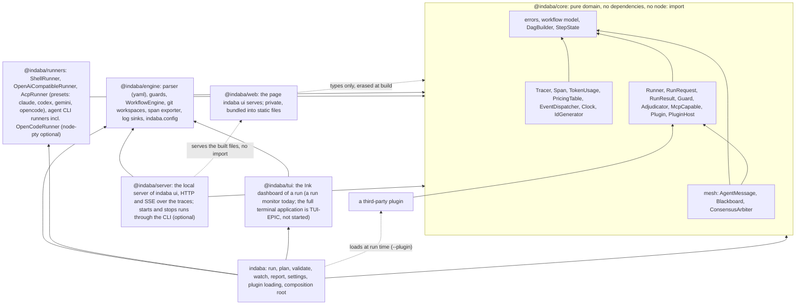
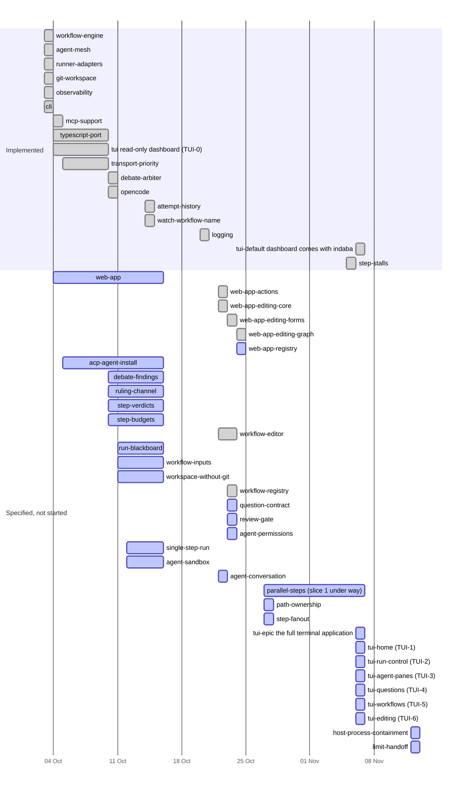
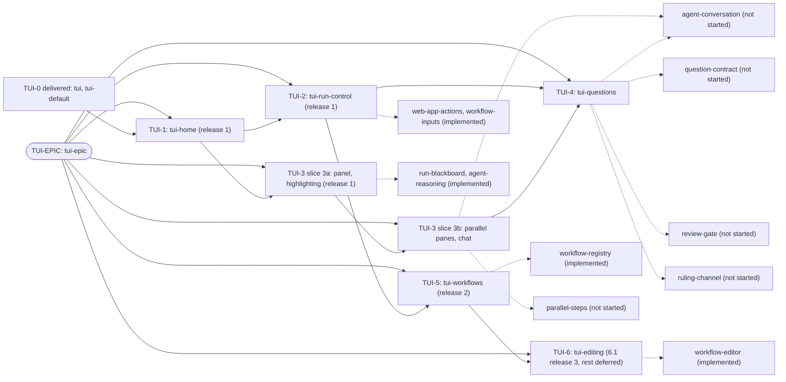

# Dependency map

How the packages depend on each other, and what breaks what. Updated at stage 8 of every feature.

## Import direction

Arrows point toward the package depended on, so `@indaba/core` sits at the bottom and imports
nothing. `engine` and `runners` never import each other; only `indaba` (the CLI) knows both, and it
registers the built-in runners and the git-diff guard through the same `PluginHost` a third-party
plugin receives. The mesh depends on the `Runner` *contract*, which lives in core, never on a
runner. A plugin depends only on the contracts in `@indaba/core`.

The guards are the layers tests: `packages/core/test/architecture.test.ts` (core imports only itself,
no `node:` module), `packages/engine/test/layers.test.ts` and `packages/runners/test/layers.test.ts`
(only relative files, `node:*`, the declared dependency and `@indaba/core`; never the runners, the
engine or the CLI upward). Two more keep the edges at the top honest. `packages/cli/test/layers.test.ts`
allows only `node:`, its own files and `@indaba/core`, `@indaba/engine` and `@indaba/runners`; the CLI
reaches `@indaba/tui` at run time, never by a static import. `packages/tui/test/layers.test.ts` allows
only its own files and `@indaba/engine`, with `ink` and `react` in a single adapter file, and fails if
core, engine or runners import the dashboard, or the CLI imports `ink`, `react` or a subpath of it.
`packages/server/test/layers.test.ts` allows its own files, `node:*`, `@indaba/core` and `@indaba/engine`, and no UI
package. `packages/web/test/layers.test.ts` allows its own files, the libraries it bundles (React, `apsw-gridwright`,
`@xyflow/react`, `@dagrejs/dagre`, the fonts) and `import type` from `@indaba/core`, and no `node:` module; it fails if
any other package imports the page. The page's libraries are build-time dependencies of a private package, so none of
them enters a consumer's tree. A new edge is a design question first
and a test change second.

## Progress

What is done and what is not, from the first day a spec was written to its last change, or to today
(2026-10-16) when nothing has shipped. Every date is a commit date from git; a bar is the time the spec
directory was being worked on, not an estimate. Grey is implemented; blue is specified and waiting.
The Status column of the next table gives the same facts with the exceptions.

`desktop-app` was dropped and is left out of the chart.

## Epics, features and stories

Large work is split as **epic, feature, story**. An epic is a spec (`specs/<epic>/`) that orders its features; each feature is a
spec of its own that is shippable alone; the stories are the numbered stories inside a feature's `spec.md`. Solid arrows are
"needs before it can ship"; a dashed arrow is a dependency on a spec that is not implemented yet.

### Epic `TUI-EPIC`: `@indaba/tui` as the real terminal application

| Epic | Feature | Stories | Ships without an unimplemented spec |
| :--- | :--- | :--- | :--- |
| `TUI-EPIC` | `TUI-1` `tui-home` | 1.1 to 1.6 | yes (release 1) |
| | `TUI-2` `tui-run-control` | 2.1 to 2.8 | yes (release 1) |
| | `TUI-3` `tui-agent-panes` | 3.1 to 3.6 | slice 3a (3.1 to 3.4) yes (release 1); slice 3b (3.5, 3.6) no |
| | `TUI-4` `tui-questions` | 4.1 to 4.6 | no (blocked) |
| | `TUI-5` `tui-workflows` | 5.1 to 5.4 | yes (release 2) |
| | `TUI-6` `tui-editing` | 6.1 to 6.6 | 6.1 yes (release 3); 6.2 to 6.6 deferred behind a demand check |

Every feature of the epic carries a parity table (web view, TUI, `--plain`/CLI), per the epic's rule R-01. The cut line is in the epic's section 3: release 1 is `TUI-1` + `TUI-2` + slice 3a.

## Feature to package

| Feature (spec) | Status | Packages |
| :--- | :--- | :--- |
| `typescript-port` | Implemented | all |
| `workflow-engine` | Implemented | `@indaba/core` (model, DAG, state), `@indaba/engine` (parser, guards, engine) |
| `agent-mesh` | Implemented | `@indaba/core` |
| `debate-arbiter` | Implemented (T16, `Adjudicator.description`, delivered with `workflow-editor`) | `@indaba/core` (`Adjudicator` contract, `PluginHost.registerAdjudicator`, the `arbiter` step field), `@indaba/engine` (parser, decision ledger, debate records, `StepExecutor`), `indaba` (the terminal arbiter) |
| `runner-adapters` | Implemented | `@indaba/core` (contract), `@indaba/runners` |
| `transport-priority` | Implemented, except T-22 (the runner contract test helper) | `@indaba/core` (runner chain, permissions model, glob, span events), `@indaba/engine` (parser, fallback loop, scope guard), `@indaba/runners` (API and ACP runners), `indaba` |
| `git-workspace` | Implemented | `@indaba/engine` |
| `observability` | Implemented | `@indaba/core` (tracer, value types), `@indaba/engine` (exporter) |
| `cli` | Implemented | `indaba` |
| `tui` | Implemented as the read-only dashboard (`TUI-0` of `tui-epic`), except one manual run on Windows Terminal | `@indaba/engine` (event stream, run view model, sanitizer), `@indaba/tui` (the dashboard), `indaba` (`watch`) |
| `mcp-support` | Implemented | `@indaba/core` (capability contracts), `@indaba/engine`, `@indaba/runners` |
| `opencode` | Implemented | `@indaba/runners` (`OpenCodeRunner`, the `opencode` ACP preset) |
| `attempt-history` | Implemented | `@indaba/engine` (`AttemptView`, `StepView.history`, plain output), `@indaba/tui` (detail pane) |
| `watch-workflow-name` | Implemented | `@indaba/engine` (`RunSummary.workflow`), `indaba` (`watch`) |
| `logging` | Implemented, except the web Settings screen (T-12, `feat/web-app-logging`) | `@indaba/core` (contract, settings, redaction), `@indaba/engine` (file, GELF and HTTP-JSON sinks, `indaba.config`, the event bridge), `@indaba/runners` (process and HTTP records), `@indaba/tui` (the Settings screen), `indaba` (the composition root, `report`, `settings`). No dependency added |
| `web-app` | In progress: delivery step 1 (the server, the page, Runs and Run, `indaba ui`) and the Settings screen are merged; step 2 has its first slice in `web-app-actions`; step 3 (editing) has 3a (`web-app-editing-core`), 3b (`web-app-editing-forms`) and 3c (`web-app-editing-graph`), planned in `plan-step-3.md` | `@indaba/core` (contract types, `RunState.structure`), `@indaba/engine` (`indaba.workflow.structure`), `@indaba/server`, `@indaba/web` (private), `indaba` (`ui`) |
| `web-app-actions` | Implemented (merged, #59), except the real-browser check at 320 px (see its `review.md`) | `@indaba/core` (contract types, `canStop`), `@indaba/server` (`RunControl`, three resources, `Origin` required on writes), `@indaba/web` (Run a workflow panel, Stop), `indaba` (`run-control/`, `kill()` of the run child). No dependency added |
| `web-app-editing-core` | Implemented (merged, #60), except the real-browser check (see its `review.md`) | `@indaba/core` (source types), `@indaba/server` (`WorkflowStore`, three resources), `@indaba/web` (the source view), `indaba` (`run-control/source.ts`). No dependency added |
| `web-app-registry` | Implemented on `feat/web-app-registry-screens`, except the real-browser check (see its `review.md`) | `@indaba/core` (registry view types), `@indaba/engine` (`isWorkflowFileName`), `@indaba/server` (`RegistryControl`, seven resources), `@indaba/web` (the Workflows screen and its dialogs), `indaba` (`run-control/registry.ts`, `roots.ts`; `indaba ui` covers the per-user folders). No dependency added |
| `web-app-editing-forms` | Implemented on `feat/web-app-editing-forms`, except the real-browser check (see its `review.md`) | `@indaba/core` (edit and editor types, `WorkflowProblem.path`), `@indaba/server` (`WorkflowEditor`, two resources), `@indaba/web` (the form), `indaba` (`run-control/editor.ts`, `problems.ts`). No dependency added |
| `web-app-editing-graph` | Implemented on `feat/web-app-editing-graph`, except the real-browser check (see its `review.md`) | `@indaba/web` (`buildWorkflowGraph`, brick and connection edit helpers, edit mode on `RunGraph`, `GraphView`, **Graph** in `SourceScreen`). No dependency added |
| `workflow-registry` | Implemented: slice 1 (#69, contract, file store, `indaba workflows`) and slice 2 (`feat/workflow-registry-ui`, `indaba ui` and the page) | `@indaba/core` (contract, `PluginHost.registerRegistry`), `@indaba/engine` (`FileWorkflowRegistry`, the walk of workflow files), `indaba` (`workflows`). No dependency added |
| `single-step-run` | Not started (specified) | `@indaba/core`, `@indaba/engine`, `indaba` |
| `agent-sandbox` | Not started (specified) | `@indaba/core` (contracts), `@indaba/engine`, `@indaba/runners`, `indaba` (container backend; a `vm` backend is a plugin, not in this repository) |
| `acp-agent-install` | Not started (specified) | `@indaba/core` (registry types), `@indaba/runners` (installer, store), `indaba` (`agents`, the consent prompt) |
| `debate-findings` | Not started (specified) | `@indaba/core`, `@indaba/engine`, `indaba` |
| `ruling-channel` | Not started (specified) | `@indaba/core`, `@indaba/engine`, `indaba` |
| `voter-arbiter` | Specification moved to a private repository (see `specs/PRIVATE.md`); not started | `@indaba/core`, `@indaba/engine`, `indaba` |
| `step-variants` | Specification moved to a private repository (see `specs/PRIVATE.md`); not started | `@indaba/core`, `@indaba/engine`, `indaba` |
| `step-verdicts` | Not started (specified) | `@indaba/core`, `@indaba/engine`, `indaba` |
| `step-budgets` | Not started (specified) | `@indaba/core`, `@indaba/engine`, `@indaba/runners`, `indaba` |
| `step-stalls` | Implemented: release 1 `timeout_seconds` (#119) and release 2 `stall` with a bounded retry (#122) | `@indaba/core` (`StallPolicy`, `StallCapable`, limits), `@indaba/runners` (`stallSeconds`, `STALL_EXIT_CODE`), `@indaba/engine` (restore of a worktree, `checkStalls`), `indaba` |
| `workflow-editor` | Implemented: part 1 (`diagnose`, #61), part 2 (`WorkflowDocument`, the schema, `indaba schema`, #62), part 3 (descriptions, `indaba catalog`, #63). Voters and prompts in the catalog wait for their specs | `@indaba/core` (descriptions, part 3), `@indaba/engine` (`diagnose`, `editor/`), `indaba` (`schema`, `catalog`). Dev dependency: `ajv` (test only) |
| `workspace-without-git` | Not started (specified) | `@indaba/core`, `@indaba/engine`, `indaba` |
| `run-blackboard` | Implemented | `@indaba/core`, `@indaba/engine`, `indaba`, `@indaba/tui` |
| `agent-reasoning` | Implemented (builds on `observability`, `runner-adapters` and `run-blackboard`) | `@indaba/core`, `@indaba/engine`, `@indaba/runners`, `indaba`, `@indaba/tui`, `@indaba/server`, `@indaba/web` |
| `tui-default` | Implemented (a packaging change; no symbol added) | `indaba` (`@indaba/tui` becomes a dependency) |
| `tui-epic` | Epic. Draft (specified; no code) | orders `TUI-1` to `TUI-6`; `@indaba/tui`, `indaba` |
| `tui-home` | Feature `TUI-1`, epic release 1. Not started (specified; draft) | `@indaba/tui`, `indaba` |
| `tui-run-control` | Feature `TUI-2`, epic release 1. Not started (specified; draft; builds on `web-app-actions`, `workflow-registry`, `workflow-inputs`) | `@indaba/tui`, `indaba` |
| `tui-agent-panes` | Feature `TUI-3`; slice 3a is epic release 1, slice 3b waits for `parallel-steps` and `agent-conversation`. Not started (specified; draft) | `@indaba/tui` |
| `tui-questions` | Feature `TUI-4`. Not started (specified; draft; blocked; waits for `agent-conversation`, `question-contract`, `review-gate`, `ruling-channel`) | `@indaba/tui`, `indaba` |
| `tui-workflows` | Feature `TUI-5`, epic release 2. Not started (specified; draft; builds on `workflow-registry`) | `@indaba/tui`, `@indaba/engine`, `indaba` |
| `tui-editing` | Feature `TUI-6`; 6.1 is epic release 3, the rest deferred behind a demand check. Not started (specified; draft; builds on `workflow-editor`) | `@indaba/tui`, `@indaba/engine`, `indaba` |
| `question-contract` | Not started (specified; draft; builds on `agent-conversation` and `run-blackboard`, neither implemented yet, and ships with or before the question loop) | `@indaba/core`, `@indaba/engine`, `indaba` |
| `review-gate` | Not started (specified; draft; builds on `step-verdicts`, `agent-conversation`, `run-blackboard` and `workspace-without-git`, none implemented yet) | `@indaba/core`, `@indaba/engine`, `indaba`, `@indaba/tui` |
| `workflow-assistant` | Not started (specified; draft; free (MIT); builds on `workflow-editor`, `web-app-editing-core`, `web-app-editing-forms`, `question-contract` and `agent-permissions`, the last two not implemented yet) | `@indaba/core`, `@indaba/engine`, `indaba`, `@indaba/server`, `@indaba/web` |
| `agent-permissions` | Implemented in `@indaba/core`, `@indaba/engine`, `@indaba/runners`, `indaba`, `@indaba/server` and `@indaba/web` (the catalog map, the `full` confirmation of the page, the editor presets; web contract 1.5.0) (specified; draft; the level `ask` is reserved for a later spec; removing the runners' hard-coded defaults is a later labelled minor) | `@indaba/core`, `@indaba/engine`, `@indaba/runners`, `indaba`, `@indaba/server`, `@indaba/web` |
| `workflow-inputs` | Not started (specified) | `@indaba/core`, `@indaba/engine`, `indaba`, `@indaba/tui` |
| `agent-conversation` | Not started (specified; draft, awaiting maintainer confirmation of the section 8 decisions) | `@indaba/core`, `@indaba/engine`, `indaba`, `@indaba/tui` |
| `parallel-steps` | In progress; the release cap is removed on `feat/parallel-steps-release` (T-15, in review), so a limit above 1 runs steps together once it is on `main`: slice 1 (#125), slice 2 (forks and landing, T-08 to T-10, #128 to #130) and slice 3 engine side (intents, contracts, negotiation, T-11 and T-12, #131 and #132); T-13 (the views show waiting steps; intents and contracts are in the dashboard board pane, the web view has no board) in review on `feat/parallel-steps-wait-views`; slice 4: T-14 (resolution of a conflicting landing) in review on `feat/parallel-steps-resolution`; T-15 lifts the cap, and review before landing (AC-21) waits for `step-verdicts`; T-16 not started. Specified; plan and tasks written, decisions C-01 to C-11 confirmed; replaces the `workflow-engine` non-goal "one step at a time") | `@indaba/core` (scheduling), `@indaba/engine` (run loop, step worktrees, landing), `indaba` (`--parallel`, `plan`), `@indaba/tui`, `@indaba/server`, `@indaba/web` (several running steps) |
| `path-ownership` | Not started (specified; decisions C-01 to C-04 confirmed; builds on `parallel-steps` and `run-blackboard`) | `@indaba/core`, `@indaba/engine`, `indaba`, `@indaba/tui`, `@indaba/server`, `@indaba/web` |
| `step-fanout` | Not started (specified; draft; builds on `parallel-steps` and `run-blackboard`; replaces the `workflow-engine` non-goal "dynamic graphs") | `@indaba/core` (`for_each`, `GraphExpander`, `PluginHost.registerGraphExpander`), `@indaba/engine`, `indaba`, `@indaba/tui`, `@indaba/server`, `@indaba/web` |
| `host-process-containment` | Not started (specified; stages 1 to 5 done; builds on `runner-adapters`, `transport-priority`, `git-workspace`, `step-stalls`; hardens host runs alongside `agent-sandbox`) | `@indaba/runners` (`buildRunnerEnvironment`, confined `.indaba/tmp`, `ClaudeRunner` `--disallowedTools Task`), `@indaba/engine` (`GitWorktree.verifyRefs` and ref rollback), `indaba` |
| `limit-handoff` | Not started (specified; stages 1 to 5 done; builds on `transport-priority`, `step-budgets`, `ruling-channel`, `git-workspace`; T-01 research on real CLI signals comes first) | `@indaba/core` (`RunLimit`, `classifyLimit`, `LimitLedger`, `decideOnLimit`, `on_limit`), `@indaba/engine` (executor, handoff note, wait), `@indaba/runners` (signal adapters), `indaba`, `@indaba/tui`, `@indaba/web` |
| `desktop-app` | Dropped | kept for history |

## What breaks what

- Changing `Runner`, `RunRequest` or `RunResult` in core breaks every runner, the mesh participant
  and every plugin's runner: a major.
- Changing `Guard`, `Plugin`, `PluginHost`, `Adjudicator` (including its `RulingRequest`) or `McpCapable`
  breaks every plugin: a major. One exception, with its reason: **adding a method to `PluginHost`** breaks no plugin,
  because plugins call the host and never implement it; it breaks only another implementation of `PluginHost`, and the
  CLI's `RegistryPluginHost` is the only one. Below 1.0 such an addition is a minor, named in the changelog (precedent:
  `registerAdjudicator` in `debate-arbiter`). Changing or removing a method is still a major.
- Changing `Logger`, `LogRecord` or `LogSink`, or what the redaction removes, changes every plugin sink and every
  log a person sends: the record shape is a major; a redaction that removes more is a minor, one that removes less
  is a major.
- Changing what goes into the decision ledger's key changes which rulings are reused: a major.
- Changing a workflow model type or the schema breaks the parser, the engine and every workflow file
  in the wild: a major.
- Renaming a span attribute or an event breaks consumers' dashboards and listeners: a major.
- Adding a member to a string-literal union (a step status, a failure action) breaks consumers who
  switch over it exhaustively. It is a major in practice; below 1.0 it takes the next minor and the changelog says so
  (precedent: `Isolation.copy` in `workspace-without-git`). A union whose readers are required by their own spec to
  treat an unknown member as unknown (the board's `BoardKind`, `run-blackboard` AC-30) is classified the same way:
  the reader rule protects the shipped readers, not a third party's exhaustive switch.
- A new runtime dependency changes every consumer's dependency tree; it is a recorded decision
  (`project.runtime_dependencies` and `project.optional_dependencies` in `workflow.ai.yml`). Today:
  `yaml` in the engine, `ink` and `react` in `@indaba/tui` (which only the optional dashboard loads), and optionally `node-pty` in the runners.

## Runtime state, not code

`.indaba/worktrees/`, `.indaba/traces/` and `.indaba/artifacts/` are produced by Indaba when it runs,
and are gitignored. `.indaba-decisions/` (the arbiter ledger) is also written by Indaba but is committed on purpose. They are unrelated to the development workflow file at the repository root.
