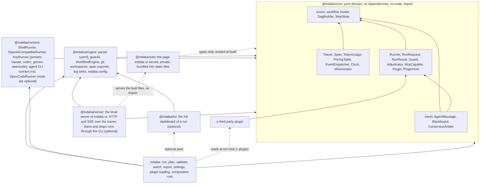
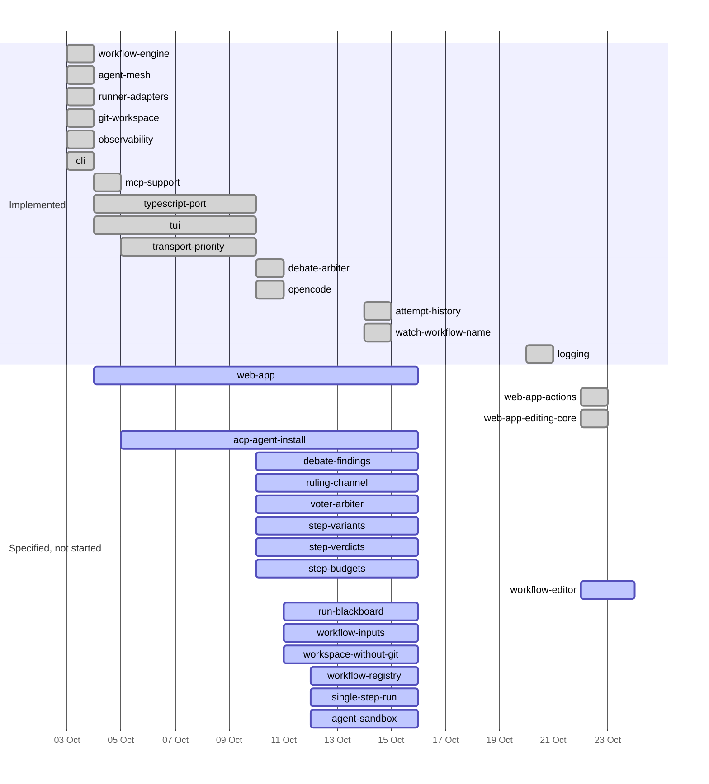

# Dependency map

How the packages depend on each other, and what breaks what. Updated at stage 8 of every feature.

## Import direction

Arrows point toward the package depended on, so `@indaba/core` sits at the bottom and imports
nothing. `engine` and `runners` never import each other; only `indaba` (the CLI) knows both, and it
registers the built-in runners and the git-diff guard through the same `PluginHost` a third-party
plugin receives. The mesh depends on the `Runner` *contract*, which lives in core, never on a
runner. A plugin depends only on the contracts in `@indaba/core`.

The guards are the layers tests: `packages/core/test/architecture.test.ts` (core imports only itself,
no `node:` module), `packages/engine/test/layers.test.ts` and `packages/runners/test/layers.test.ts`
(only relative files, `node:*`, the declared dependency and `@indaba/core`; never the runners, the
engine or the CLI upward). Two more keep the edges at the top honest. `packages/cli/test/layers.test.ts`
allows only `node:`, its own files and `@indaba/core`, `@indaba/engine` and `@indaba/runners`; the CLI
reaches `@indaba/tui` at run time, never by a static import. `packages/tui/test/layers.test.ts` allows
only its own files and `@indaba/engine`, with `ink` and `react` in a single adapter file, and fails if
core, engine or runners import the dashboard, or the CLI imports `ink`, `react` or a subpath of it.
`packages/server/test/layers.test.ts` allows its own files, `node:*`, `@indaba/core` and `@indaba/engine`, and no UI
package. `packages/web/test/layers.test.ts` allows its own files, the libraries it bundles (React, `apsw-gridwright`,
`@xyflow/react`, `@dagrejs/dagre`, the fonts) and `import type` from `@indaba/core`, and no `node:` module; it fails if
any other package imports the page. The page's libraries are build-time dependencies of a private package, so none of
them enters a consumer's tree. A new edge is a design question first
and a test change second.

## Progress

What is done and what is not, from the first day a spec was written to its last change, or to today
(2026-10-16) when nothing has shipped. Every date is a commit date from git; a bar is the time the spec
directory was being worked on, not an estimate. Grey is implemented; blue is specified and waiting.
The Status column of the next table gives the same facts with the exceptions.

`desktop-app` was dropped and is left out of the chart.

## Feature to package

| Feature (spec) | Status | Packages |
| :--- | :--- | :--- |
| `typescript-port` | Implemented | all |
| `workflow-engine` | Implemented | `@indaba/core` (model, DAG, state), `@indaba/engine` (parser, guards, engine) |
| `agent-mesh` | Implemented | `@indaba/core` |
| `debate-arbiter` | Implemented (T16, `Adjudicator.description`, delivered with `workflow-editor`) | `@indaba/core` (`Adjudicator` contract, `PluginHost.registerAdjudicator`, the `arbiter` step field), `@indaba/engine` (parser, decision ledger, debate records, `StepExecutor`), `indaba` (the terminal arbiter) |
| `runner-adapters` | Implemented | `@indaba/core` (contract), `@indaba/runners` |
| `transport-priority` | Implemented, except T-22 (the runner contract test helper) | `@indaba/core` (runner chain, permissions model, glob, span events), `@indaba/engine` (parser, fallback loop, scope guard), `@indaba/runners` (API and ACP runners), `indaba` |
| `git-workspace` | Implemented | `@indaba/engine` |
| `observability` | Implemented | `@indaba/core` (tracer, value types), `@indaba/engine` (exporter) |
| `cli` | Implemented | `indaba` |
| `tui` | Implemented, except one manual run on Windows Terminal | `@indaba/engine` (event stream, run view model, sanitizer), `@indaba/tui` (the dashboard), `indaba` (`watch`) |
| `mcp-support` | Implemented | `@indaba/core` (capability contracts), `@indaba/engine`, `@indaba/runners` |
| `opencode` | Implemented | `@indaba/runners` (`OpenCodeRunner`, the `opencode` ACP preset) |
| `attempt-history` | Implemented | `@indaba/engine` (`AttemptView`, `StepView.history`, plain output), `@indaba/tui` (detail pane) |
| `watch-workflow-name` | Implemented | `@indaba/engine` (`RunSummary.workflow`), `indaba` (`watch`) |
| `logging` | Implemented, except the web Settings screen (T-12, `feat/web-app-logging`) | `@indaba/core` (contract, settings, redaction), `@indaba/engine` (file, GELF and HTTP-JSON sinks, `indaba.config`, the event bridge), `@indaba/runners` (process and HTTP records), `@indaba/tui` (the Settings screen), `indaba` (the composition root, `report`, `settings`). No dependency added |
| `web-app` | In progress: delivery step 1 (the server, the page, Runs and Run, `indaba ui`) and the Settings screen are merged; step 2 has its first slice in `web-app-actions`; step 3 (editing) is planned in `plan-step-3.md` | `@indaba/core` (contract types, `RunState.structure`), `@indaba/engine` (`indaba.workflow.structure`), `@indaba/server`, `@indaba/web` (private), `indaba` (`ui`) |
| `web-app-actions` | Implemented (merged, #59), except the real-browser check at 320 px (see its `review.md`) | `@indaba/core` (contract types, `canStop`), `@indaba/server` (`RunControl`, three resources, `Origin` required on writes), `@indaba/web` (Run a workflow panel, Stop), `indaba` (`run-control/`, `kill()` of the run child). No dependency added |
| `web-app-editing-core` | Implemented (merged, #60), except the real-browser check (see its `review.md`) | `@indaba/core` (source types), `@indaba/server` (`WorkflowStore`, three resources), `@indaba/web` (the source view), `indaba` (`run-control/source.ts`). No dependency added |
| `workflow-registry` | Not started (specified) | `@indaba/core` (contract), `@indaba/engine` (file store), `indaba` |
| `single-step-run` | Not started (specified) | `@indaba/core`, `@indaba/engine`, `indaba` |
| `agent-sandbox` | Not started (specified) | `@indaba/core` (contracts), `@indaba/engine`, `@indaba/runners`, `indaba` (container backend) |
| `acp-agent-install` | Not started (specified) | `@indaba/core` (registry types), `@indaba/runners` (installer, store), `indaba` (`agents`, the consent prompt) |
| `debate-findings` | Not started (specified) | `@indaba/core`, `@indaba/engine`, `indaba` |
| `ruling-channel` | Not started (specified) | `@indaba/core`, `@indaba/engine`, `indaba` |
| `voter-arbiter` | Not started (specified) | `@indaba/core`, `@indaba/engine`, `indaba` |
| `step-variants` | Not started (specified) | `@indaba/core`, `@indaba/engine`, `indaba` |
| `step-verdicts` | Not started (specified) | `@indaba/core`, `@indaba/engine`, `indaba` |
| `step-budgets` | Not started (specified) | `@indaba/core`, `@indaba/engine`, `@indaba/runners`, `indaba` |
| `workflow-editor` | Implemented: part 1 (`diagnose`, #61), part 2 (`WorkflowDocument`, the schema, `indaba schema`, #62), part 3 (descriptions, `indaba catalog`, on `feat/workflow-editor-catalog`). Voters and prompts in the catalog wait for their specs | `@indaba/core` (descriptions, part 3), `@indaba/engine` (`diagnose`, `editor/`), `indaba` (`schema`, `catalog`). Dev dependency: `ajv` (test only) |
| `workspace-without-git` | Not started (specified) | `@indaba/core`, `@indaba/engine`, `indaba` |
| `run-blackboard` | Not started (specified) | `@indaba/core`, `@indaba/engine`, `indaba`, `@indaba/tui` |
| `workflow-inputs` | Not started (specified) | `@indaba/core`, `@indaba/engine`, `indaba`, `@indaba/tui` |
| `desktop-app` | Dropped | kept for history |

## What breaks what

- Changing `Runner`, `RunRequest` or `RunResult` in core breaks every runner, the mesh participant
  and every plugin's runner: a major.
- Changing `Guard`, `Plugin`, `PluginHost`, `Adjudicator` (including its `RulingRequest`) or `McpCapable`
  breaks every plugin: a major.
- Changing `Logger`, `LogRecord` or `LogSink`, or what the redaction removes, changes every plugin sink and every
  log a person sends: the record shape is a major; a redaction that removes more is a minor, one that removes less
  is a major.
- Changing what goes into the decision ledger's key changes which rulings are reused: a major.
- Changing a workflow model type or the schema breaks the parser, the engine and every workflow file
  in the wild: a major.
- Renaming a span attribute or an event breaks consumers' dashboards and listeners: a major.
- Adding a member to a string-literal union (a step status, a failure action) breaks consumers who
  switch over it exhaustively.
- A new runtime dependency changes every consumer's dependency tree; it is a recorded decision
  (`project.runtime_dependencies` and `project.optional_dependencies` in `workflow.ai.yml`). Today:
  `yaml` in the engine, `ink` and `react` in `@indaba/tui` (which only the optional dashboard loads), and optionally `node-pty` in the runners.

## Runtime state, not code

`.indaba/worktrees/`, `.indaba/traces/` and `.indaba/artifacts/` are produced by Indaba when it runs,
and are gitignored. `.indaba-decisions/` (the arbiter ledger) is also written by Indaba but is committed on purpose. They are unrelated to the development workflow file at the repository root.
